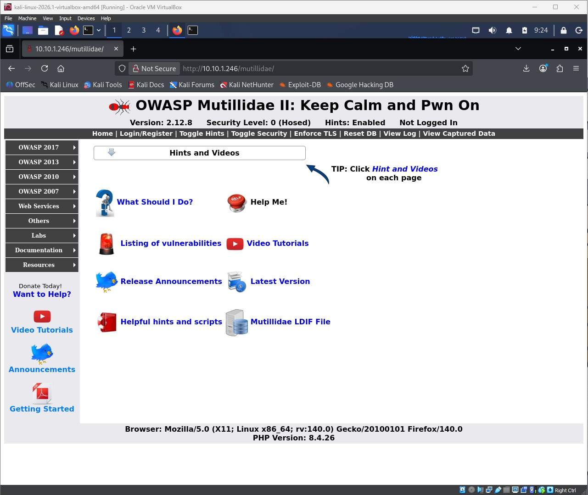
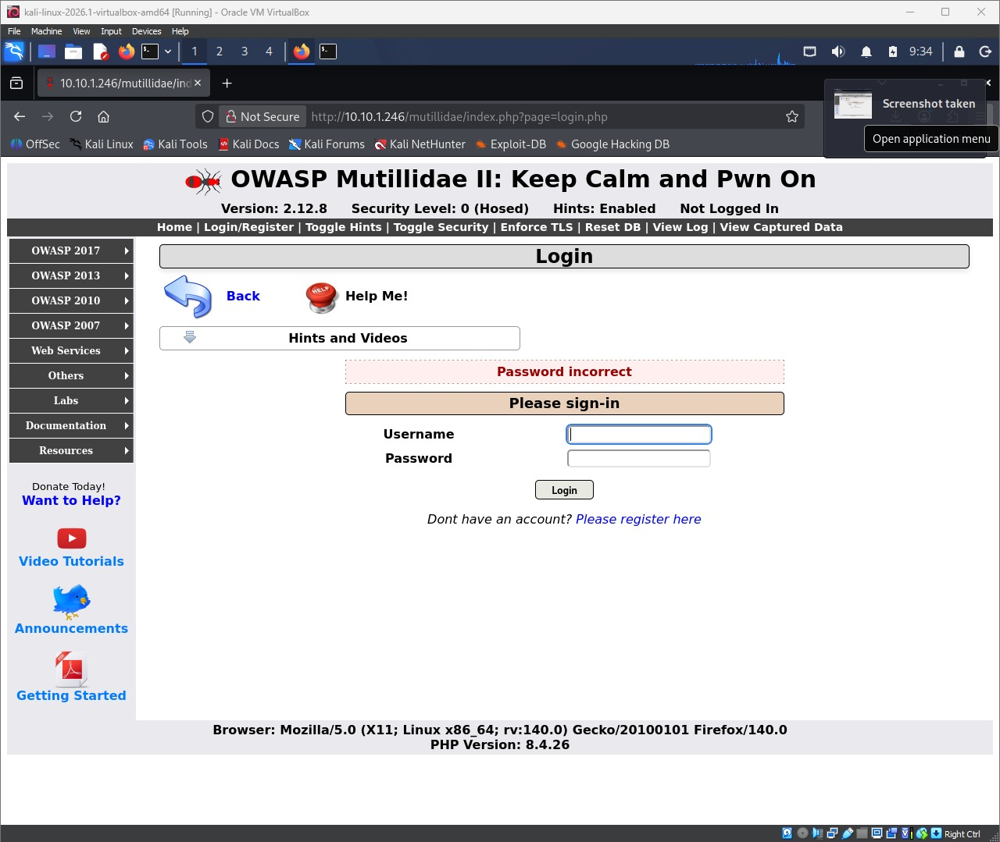
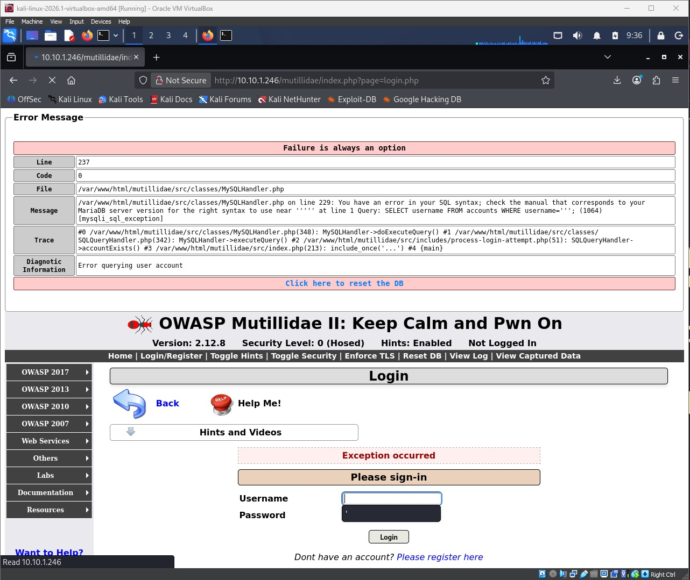
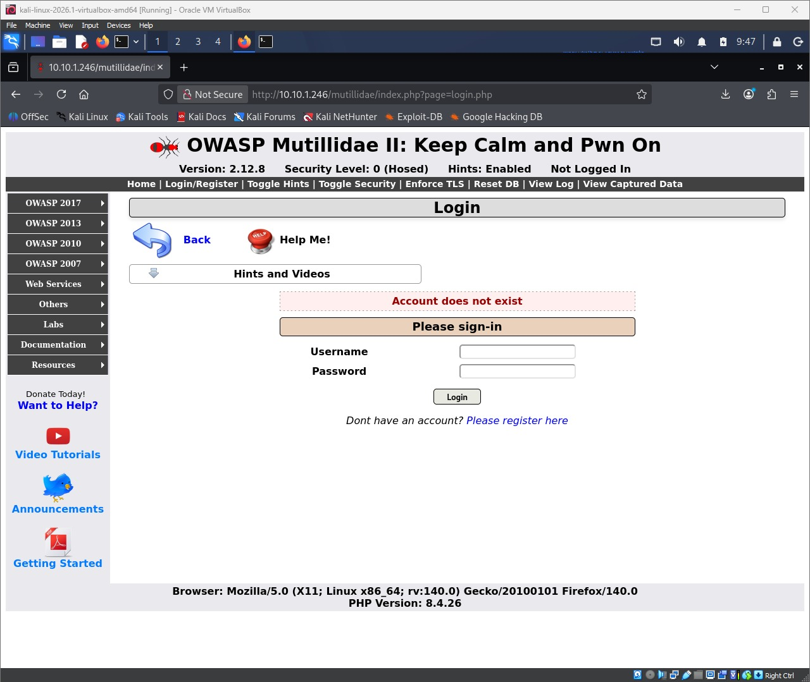
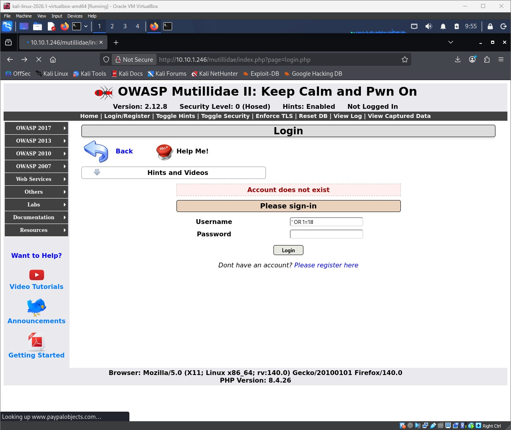
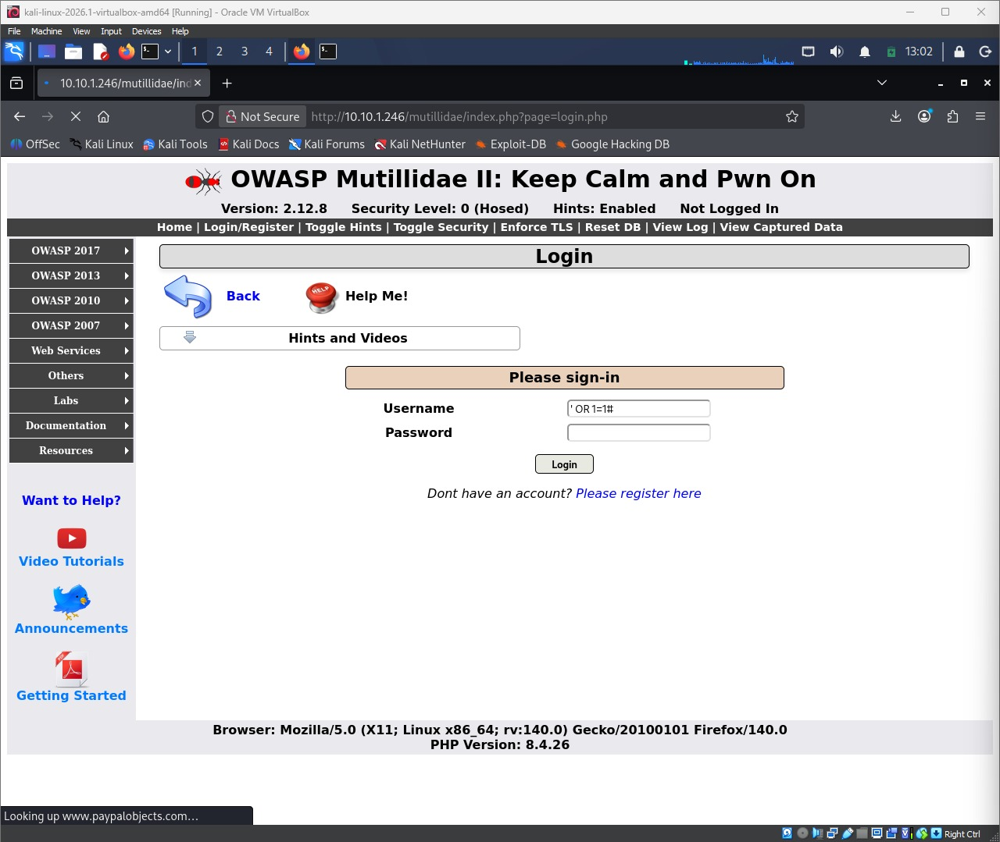
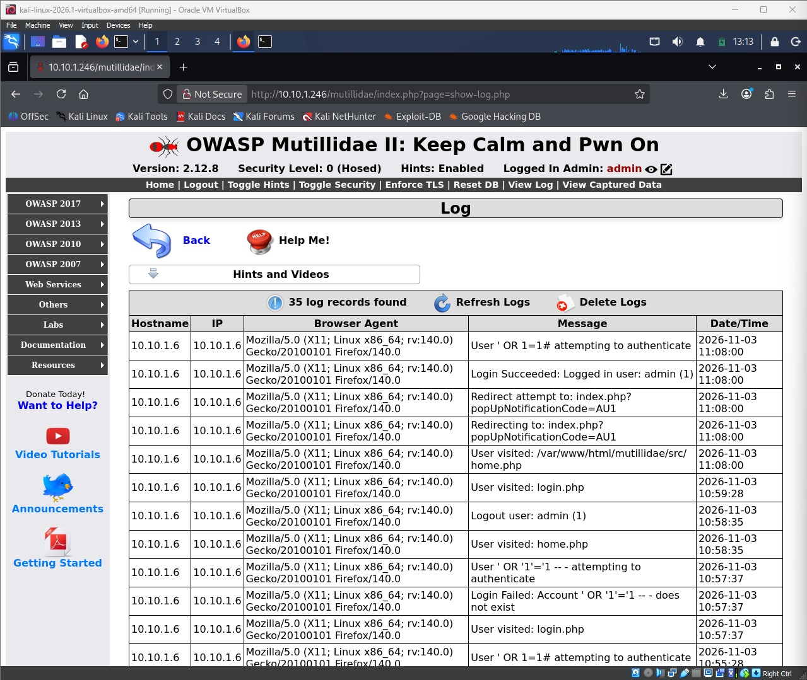

# Task 1 — SQL Injection — Authentication Bypass

| | |
|---|---|
| Candidate / ID | Elizabeth Oluwatolani Peter Odubiyi / Cybersecurity2026 |
| Target | tc-corp-server (IP: `10.10.1.246`) · App: OWASP Mutillidae II |
| Tools used | Firefox, manual SQL injection payloads (no sqlmap) |

## 1. Objective

Identify and exploit a SQL injection vulnerability in OWASP Mutillidae II's login form to bypass authentication, recording every payload tried until access was gained.

## 2. Methodology (step by step)

1. Opened OWASP Mutillidae II at `http://10.10.1.246/mutillidae/` and navigated to the Login page.
2. Tried a normal, invalid login first to see the application's baseline behaviour — it returned "Password incorrect".
3. Tested the login field for injectability by entering a single quote (`'`). The application threw a raw MySQL error disclosing the underlying query: `SELECT username FROM accounts WHERE username=''';` This confirmed that user input is concatenated directly into the SQL statement with no sanitisation or parameterisation — a classic SQL injection indicator.
4. Using the disclosed query structure, attempted a tautology-based authentication bypass with the username field set to `' OR '1'='1' -- ` and the password left blank. The application responded "Account does not exist" — the attempt failed.
5. Reformulated the payload using a different comment style: `' OR 1=1#` as the username, password left blank.
6. Submitted the payload. The application authenticated the request and redirected to the home page, now showing **"Logged In Admin: admin"**.
7. Confirmed the result through two independent pieces of evidence: the logged-in banner in the UI, and Mutillidae's own **View Log** page, which recorded both authentication attempts — the failed one and the successful one — with timestamps.

## 3. Payloads / commands tried (in order)

| # | Payload / command | Result |
|---|---|---|
| 1 | `'` entered into the login field | MySQL syntax error returned — confirmed the parameter is unsanitised/not parameterised (injectable) |
| 2 | Username: `' OR '1'='1' -- `, Password: *(blank)* | Login Failed — "Account `' OR '1'='1' -- ` does not exist" |
| 3 ✅ | Username: `' OR 1=1#`, Password: *(blank)* | **Login Succeeded** — authenticated as `admin` (user id 1), objective achieved |

## 4. Evidence (screenshots)

Note: OWASP Mutillidae II home page, Security Level 0, confirming the target application and lab setup before testing began.

Note: A normal invalid login first, returning "Password incorrect" — establishes expected application behaviour.

Note: A single quote submitted in the login field triggers a MySQL syntax error, disclosing the raw query and confirming the field is injectable.

Note: The payload `' OR '1'='1' -- ` is rejected with "Account does not exist".

Note: The username field now contains the payload `' OR 1=1#`, about to be submitted.

Note: The login request with `' OR 1=1#` is being submitted to the server.

Note: **Proof of access** — the application now shows "Logged In Admin: admin", confirming the authentication bypass succeeded.

Note: Mutillidae's own View Log page corroborates the attack: the `' OR '1'='1' -- ` attempt is logged as a login failure, and the `' OR 1=1#` attempt is logged immediately followed by "Login Succeeded: Logged in user: admin (1)".

## 5. Analysis

The login form builds its SQL query by directly concatenating the submitted username into a `SELECT` statement, with no parameterisation or input sanitisation. Submitting a single quote broke out of the string literal early and caused a MySQL syntax error, which both confirmed the flaw and revealed the exact shape of the query (`SELECT username FROM accounts WHERE username='<input>'`).

Knowing this, the payload `' OR 1=1#` closes the opening quote, appends an always-true condition (`1=1`), and then comments out everything after it with `#`. The resulting query is effectively `... WHERE username='' OR 1=1`, which is always true and returns the first account in the table (admin) — letting the application treat the request as a successful login without knowing any real password.

The first payload, `' OR '1'='1' -- `, is logically equivalent but was rejected. The likely reason is MySQL's comment syntax: `--` is only treated as a comment if it is followed by whitespace. If that trailing space is not preserved exactly as sent (for example, trimmed by the browser/application, or not interpreted as expected by the query handler), the rest of the original query is not actually commented out and the lookup fails to resolve to a valid row, producing "Account does not exist". The `#` comment style has no such whitespace requirement and immediately terminates the rest of the query, which is why it succeeded where the `--` version did not.

## 6. Remediation / defence

- Use parameterised queries / prepared statements for all database access — never concatenate user input directly into SQL strings.
- Apply server-side input validation (type/length/character allow-listing) in addition to parameterisation.
- Run the database connection with a least-privilege account that cannot be used to escalate beyond what the application needs.
- Return generic error messages to users; disable verbose database error output in production so query structure is never disclosed.
- Add rate-limiting / account lockout on the login endpoint to slow down manual and automated injection attempts.
- Log and alert on repeated authentication attempts containing SQL metacharacters (`'`, `--`, `#`, `OR 1=1`, etc.).
