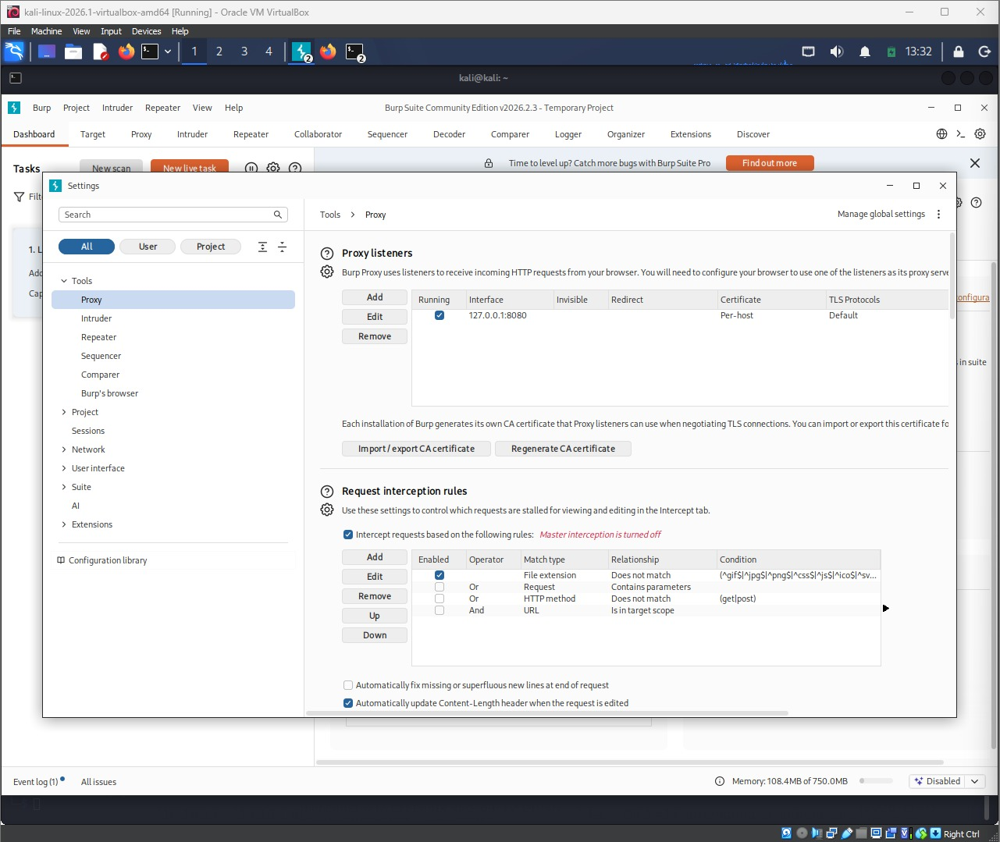
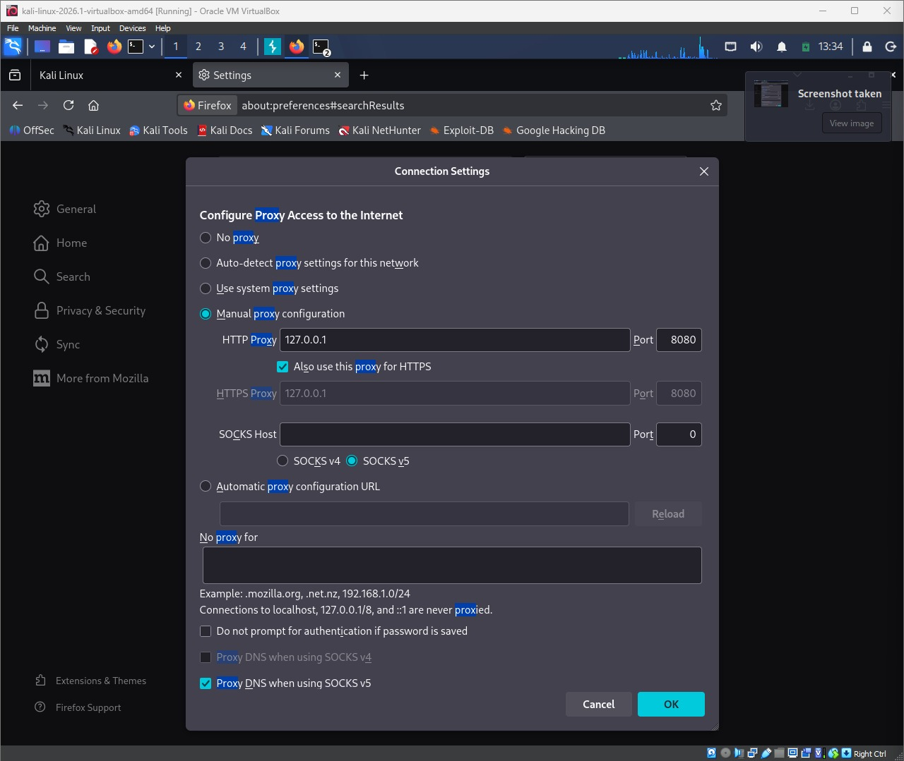
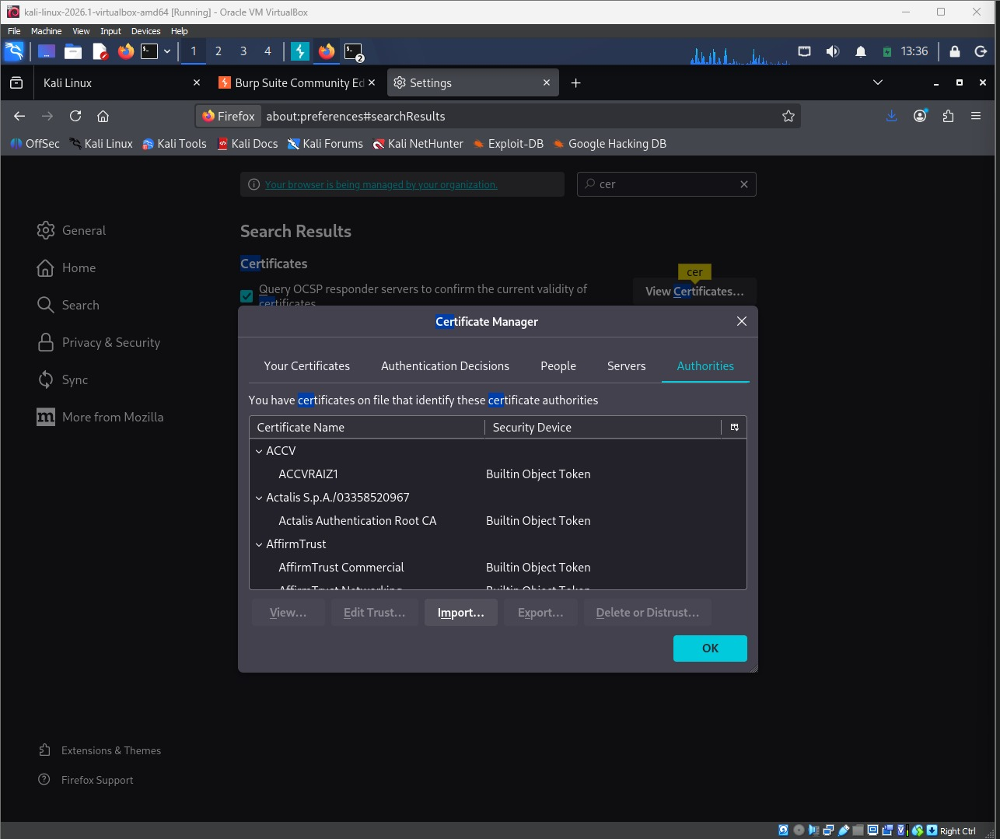
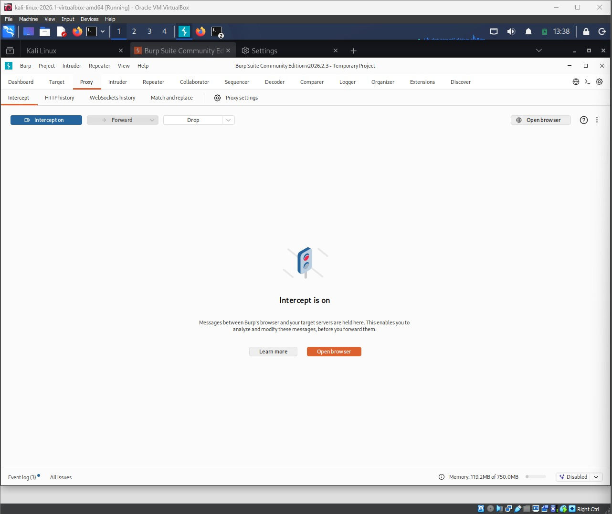
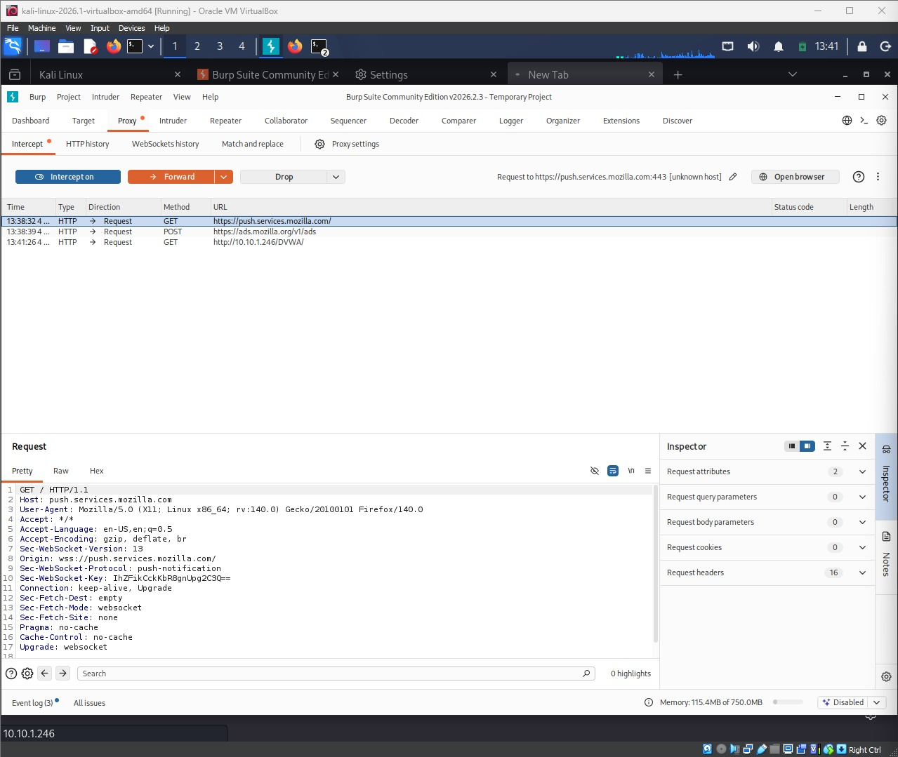
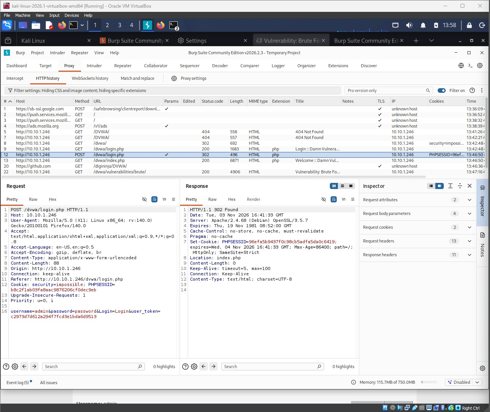
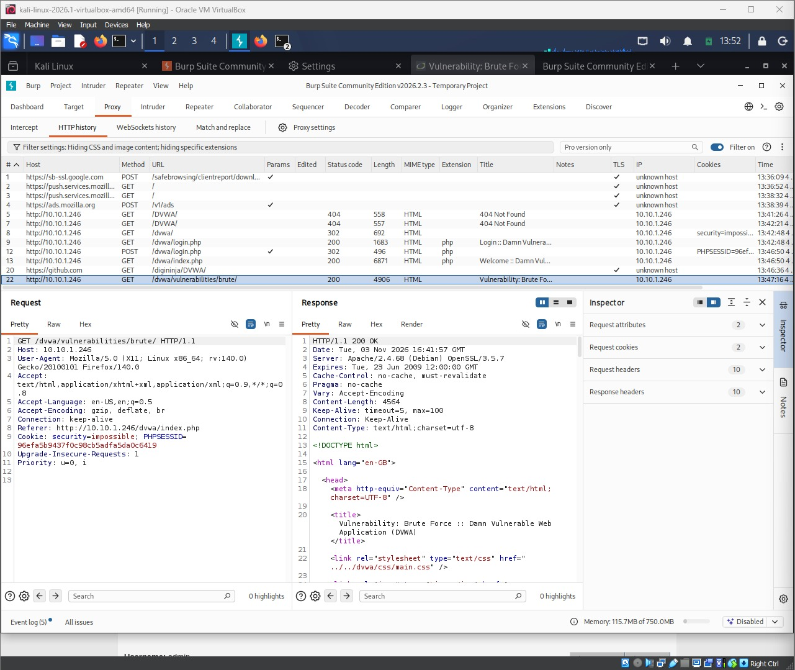

# Task 2 — HTTP Interception & Traffic Analysis

| | |
|---|---|
| Candidate / ID | Elizabeth Oluwatolani Peter Odubiyi / Cybersecurity2026 |
| Target | tc-corp-server (IP: `10.10.1.246`) · App: DVWA (Damn Vulnerable Web Application) |
| Tools used | Burp Suite Community Edition v2026.2.3, Firefox |

## 1. Objective

Configure Firefox to proxy through Burp Suite, capture the HTTP traffic generated while browsing DVWA, analyse it, and identify and document the HTTP form(s) the application uses.

## 2. Methodology (step by step)

1. Opened Burp Suite Community Edition and confirmed, under Proxy → Proxy settings, that the proxy listener was running on `127.0.0.1:8080`.
2. Configured Firefox's connection settings for manual proxy configuration: HTTP Proxy `127.0.0.1`, port `8080`, with "Also use this proxy for HTTPS" enabled, so both HTTP and HTTPS traffic from the browser routes through Burp.
3. Exported Burp's CA certificate and imported it into Firefox's Certificate Manager (Authorities tab), so Firefox would trust Burp's re-issued TLS certificates and HTTPS interception would not throw certificate warnings.
4. In Burp's Proxy → Intercept tab, switched interception on so requests would be held for inspection.
5. Browsed to DVWA on the target (`http://10.10.1.246/DVWA/`, then `/dvwa/login.php`) from Firefox. Burp's proxy history began logging every request — including unrelated background Firefox traffic (e.g. `push.services.mozilla.com`, `ads.mozilla.org`), which confirmed the proxy was capturing all browser traffic, not just requests to the target.
6. Logged into DVWA using the on-page form and captured the resulting request/response pair in Burp's HTTP history.
7. Continued to an authenticated page (`/dvwa/vulnerabilities/brute/`) and inspected the follow-up request to see how the session was maintained after login.
8. Reviewed the captured requests in the HTTP history and Inspector panes to identify method, URL/action, and parameters for the login form.

## 3. Requests captured (in order)

| # | Request | Result |
|---|---|---|
| 1 | `GET /dvwa/login.php` | 200 — login form served; `security=impossible` cookie set |
| 2 | `POST /dvwa/login.php` Body: `username=admin&password=password&Login=Login&user_token=c2973d7d61a294f7fcd3e1bda6d9513` | 302 Found — redirected to `index.php`; new `PHPSESSID` cookie issued |
| 3 | `GET /dvwa/index.php` | 200 — authenticated DVWA dashboard loaded ("Welcome :: Damn Vulnerable Web Application"), using the new session cookie |
| 4 ✅ | `GET /dvwa/vulnerabilities/brute/` | 200 — authenticated page loaded successfully, carrying the `security` and `PHPSESSID` cookies set at login; confirms the session persists across requests |

## 4. Identified form — DVWA Login

| Field | Value |
|---|---|
| Method | `POST` |
| Action (URL) | `/dvwa/login.php` |
| Content-Type | `application/x-www-form-urlencoded` |
| Parameters | `username` (text) — e.g. `admin` `password` (text) — e.g. `password` `Login` (submit button value) — `Login` `user_token` (hidden, per-page-load CSRF token) — e.g. `c2973d7d61a294f7fcd3e1bda6d9513` |
| Response | `302 Found` → `Location: index.php`; `Set-Cookie: PHPSESSID=...; HttpOnly; SameSite=Strict`, alongside the existing `security=impossible` cookie |

## 5. Evidence (screenshots)

Note: Burp Suite's Proxy listener confirmed running on `127.0.0.1:8080`.

Note: Firefox manual proxy set to `127.0.0.1:8080` for both HTTP and HTTPS, routing all browser traffic through Burp.

Note: Burp's CA certificate imported into Firefox's Certificate Manager so HTTPS traffic can be decrypted and inspected without warnings.

Note: Proxy → Intercept set to "Intercept is on", ready to hold and inspect requests.

Note: Evidence the proxy is working — captured requests including a `GET` to the DVWA target alongside unrelated Firefox background traffic, proving interception is active.

Note: **Key evidence** — the captured `POST /dvwa/login.php` request, showing the full form body (`username`, `password`, `Login`, `user_token`) and the `302` response setting a new `PHPSESSID` session cookie.

Note: A subsequent authenticated request (`/dvwa/vulnerabilities/brute/`) carrying the `security` and `PHPSESSID` cookies set at login, showing the session is maintained via cookies.

## 6. Analysis

The captured traffic shows the DVWA login form submits credentials as a standard URL-encoded `POST` body in cleartext, since this lab instance is served over plain HTTP rather than HTTPS. Alongside `username` and `password`, the form includes a hidden `user_token` field — a per-page CSRF token the server generates and expects back unchanged, so a valid token must be captured and replayed together with any credentials for an automated or scripted login to succeed. On a successful login, the server responds with a `302` redirect to `index.php` and issues a fresh `PHPSESSID` cookie; that cookie is then sent on every subsequent request (seen on the follow-up request to `/dvwa/vulnerabilities/brute/`), which is how DVWA recognises the browser as an authenticated session over the stateless HTTP protocol.

Intercepting proxies like Burp Suite are valuable to a tester because they expose everything happening between the browser and the server that the rendered page alone does not show: exact parameter names, hidden fields such as `user_token`, cookie values and their flags, and full response headers. This is essential both for understanding an application's real attack surface (for example, before attempting credential brute-forcing or parameter tampering) and for building an accurate, evidence-based picture of how the application actually behaves, rather than relying on what the UI appears to do.

## 7. Remediation / defence

- Serve the login form and the whole session over HTTPS end-to-end (not just in production) to prevent credentials and session cookies from being sent or sniffed in cleartext.
- Ensure session cookies carry the `Secure` flag in addition to `HttpOnly` and `SameSite`, so they are never sent over an unencrypted connection.
- Keep the CSRF token (`user_token`) randomised per session/request and validated server-side on every state-changing request.
- Do not ship or allow default/weak credentials (e.g. `admin` / `password`) in any environment reachable beyond an isolated training lab.
- Apply rate-limiting or account lockout on the login endpoint to reduce the value of intercepted requests for credential-stuffing or brute-force attempts.
- Never allow a client-controlled cookie (such as DVWA's own `security` difficulty cookie) to influence security behaviour in a real application — security posture must be enforced entirely server-side.
